# HydroRaksh aka JalSuraksha: Collaborative Filtering and Latent Topic Analysis for AI-Driven Groundwater Intelligence and Water Resource Decision Support

[-248653.svg)](tests/unit)
[](apps/web)
[](apps/api)
[](ml/notebooks)
[](docker-compose.yml)
[](apps/web/src/app/globals.css)

---

## Project Ownership and Attribution

| Field | Details |
| :--- | :--- |
| **Project Owner & Lead** | **Mohd Shami** |
| **Academic Program** | **B.Tech Data Science** |
| **Official Email** | [codexshami@gmail.com](mailto:codexshami@gmail.com) |
| **Personal Portfolio** | [https://mohdshamii.github.io](https://mohdshamii.github.io) |
| **GitHub Profile** | [https://github.com/mohdshamii](https://github.com/mohdshamii) |
| **LinkedIn Profile** | [https://linkedin.com/in/modshamii](https://linkedin.com/in/modshamii) |

> **Independent Project Notice:**  
> JalSuraksha is an independent geospatial artificial intelligence, data engineering, and hydrological decision-support platform engineered by Mohd Shami. Inspired by the clean, accessible, and trustworthy aesthetic of open public-information portals (such as India.gov.in), JalSuraksha is an independent research platform and is **not** an official Government of India or state department website. All hydrological telemetry and meteorological observations are compiled from publicly accessible records published by the Central Ground Water Board (CGWB), India Meteorological Department (IMD), India-WRIS, and Central Water Commission (CWC).

---

## Abstract

Groundwater depletion represents an existential challenge to agricultural sustainability, urban water security, and socio-economic resilience across India, where over 63% of irrigated cropland and 85% of rural drinking supplies depend on unconfined and semi-confined aquifers. Conventional monitoring systems rely predominantly on centralized numerical simulations (e.g., MODFLOW) and quarterly manual piezometer measurements that exhibit significant latency, sparse observation frequency, and an inability to provide localized, cost-optimized engineering prescriptions.

This repository implements **JalSuraksha**, an enterprise-grade geospatial artificial intelligence and decision-support platform designed to transform groundwater governance from retrospective manual reporting to real-time, prescriptive intelligence. The platform delivers:
- **Pan-India Dynamic Geography:** Seamless dynamic navigation across all **36 States and Union Territories and 700+ administrative districts**, with **Uttar Pradesh** serving as the reference implementation. Selecting any state updates district boundaries, maps, water table observations, rainfall, and predictive analytics.
- **Hydro-Geological Context-Aware Collaborative Filtering (HG-CF):** Solves the cold-start recommendation problem for newly instrumented or data-sparse blocks by embedding physical aquifer attributes (hydraulic conductivity, slope, monsoon rainfall departure, extraction stage) into a graph Laplacian regularization kernel.
- **Hydrological Document Topic Modeling (LDA):** Synthesizes unstructured hydrogeological brochures, ground water reports, and citizen grievance reports into qualitative distress signals.
- **Dual Water Metrics & Integrity Architecture:** Simultaneously displays groundwater depth (m bgl) and multi-parameter water quality (pH, electrical conductivity, TDS, fluoride, arsenic, nitrate) with explicit timestamped provenance labels (`Live`, `Delayed`, `Cached`, `Simulated`, `Unavailable`).
- **India.gov.in-Inspired Interface:** Clean, high-contrast, accessible public data portal aesthetic featuring Navy (`#12345A`), Secondary Blue (`#245B8F`), Saffron (`#E88B2A`), and Green (`#248653`) tokens, with a functional persistent Light/Dark theme toggle and zero emojis.
- **Reproducible Machine Learning Workspace:** 16 self-contained Jupyter notebooks (`00_` to `15_`), serialized production models, unified data pipelines, and a dedicated research Docker container.

---

## Table of Contents

1. [Executive Summary and Platform Overview](#1-executive-summary-and-platform-overview)
2. [Verified Application Screenshots and Visual Interface Showcase](#2-verified-application-screenshots-and-visual-interface-showcase)
   - 2.1 [Geospatial Map Layers & Multi-State Exploration](#21-geospatial-map-layers--multi-state-exploration)
   - 2.2 [Telemetry Ingestion, Temporal Horizons & Hydrological Benchmarks](#22-telemetry-ingestion-temporal-horizons--hydrological-benchmarks)
   - 2.3 [JalRakshak AI Prescriptive Decision-Support Suite](#23-jalrakshak-ai-prescriptive-decision-support-suite)
   - 2.4 [Complete Visual Assets Inventory](#24-complete-visual-assets-inventory)
3. [Visual Design and Theme System](#3-visual-design-and-theme-system)
4. [System Architecture and Monorepo Structure](#4-system-architecture-and-monorepo-structure)
5. [Pan-India Dynamic Geography](#5-pan-india-dynamic-geography)
6. [Machine Learning and Research Infrastructure](#6-machine-learning-and-research-infrastructure)
   - 6.1 [16 Jupyter Research Notebooks Catalogue](#61-16-jupyter-research-notebooks-catalogue)
   - 6.2 [Empirical Evaluation Benchmarks](#62-empirical-evaluation-benchmarks)
   - 6.3 [Mathematical Formulations](#63-mathematical-formulations)
7. [Platform Modules and Operational Capabilities](#7-platform-modules-and-operational-capabilities)
   - 7.1 [Dynamic Water Balance Audit](#71-dynamic-water-balance-audit)
   - 7.2 [AI Recharge Suitability & Sizing](#72-ai-recharge-suitability--sizing)
   - 7.3 [Non-Revenue Water (NRW) Leakage Engine](#73-non-revenue-water-nrw-leakage-engine)
   - 7.4 [Borewell Failure Portal](#74-borewell-failure-portal)
   - 7.5 [District Comparison Matrix & Duel Arena](#75-district-comparison-matrix--duel-arena)
   - 7.6 [Historical Continuous Playback (2000–2035)](#76-historical-continuous-playback-20002035)
8. [Data Sources, Provenance and Integrity](#8-data-sources-provenance-and-integrity)
9. [Installation and Local Execution](#9-installation-and-local-execution)
10. [Docker Containerization](#10-docker-containerization)
11. [Testing and Verification](#11-testing-and-verification)
12. [API Reference and Data Contracts](#12-api-reference-and-data-contracts)
13. [Academic References and Citation](#13-academic-references-and-citation)

---

## 1. Executive Summary and Platform Overview

India withdraws approximately 245 billion cubic meters (BCM) of groundwater annually, surpassing the combined withdrawals of the United States and China. Over 17% of administrative assessment units are classified as **Over-Exploited**, with extraction surpassing replenishable recharge.

JalSuraksha bridges the gap between raw hydrological observations and administrative policy interventions:
- **36 States and Union Territories Covered:** Fully dynamic geography allows instant exploration of any state/UT and district across India.
- **Uttar Pradesh Reference Baseline:** Features all 75 districts across 18 administrative divisions with calibrated vector maps, 35-year temporal trajectories (2000–2035), telemetry endpoints, and dual water quality metrics.
- **Prescriptive Decision Suite:** Knapsack capital budget optimization, crop-shift diversification recommendations, rooftop rainwater harvesting (RWH) financial payback calculations, and What-If aquifer stress-testing.
- **Enterprise-Grade Stack:** Next.js 15 App Router frontend with Tailwind CSS tokens; FastAPI asynchronous backend with SQLAlchemy ORM, TimescaleDB telemetry tables, and JSON user authentication fallback.

---

## 2. Verified Application Screenshots and Visual Interface Showcase

All 21 visual figures below are captured directly from the live JalSuraksha application environment (`img/`), providing high-fidelity visual documentation of every core interface, map layer, decision suite module, and analytical tool:

### 2.1 Geospatial Map Layers & Multi-State Exploration

#### Figure 1: Core Geospatial Map Canvas & Real-Time Intelligence Dashboard
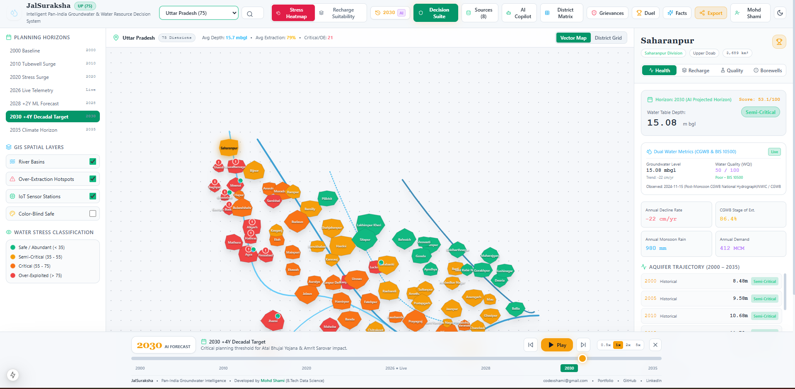
*Figure 1: Core JalSuraksha desktop interface showing the interactive Uttar Pradesh 75-district vector choropleth map, regional river basin vectors (Ganga, Yamuna), over-extraction risk classifications, continuous 2030 +4Y decadal timeline dock, and Saharanpur district intelligence dossier.*

#### Figure 2: Uttar Pradesh State-Level Dashboard (Critical Stress Filter)
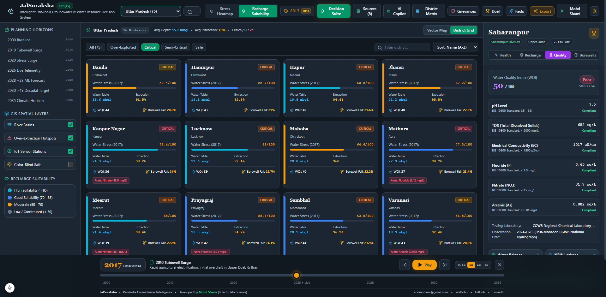
*Figure 2: Dark theme state-level dashboard displaying the 75-district grid filtered by Critical risk units (Banda, Hamirpur, Hapur, Jhansi, Kanpur Nagar, Lucknow, Mahoba, Mathura, Meerut, Prayagraj, Sambhal, Varanasi) with Saharanpur multi-parameter water quality laboratory assays.*

#### Figure 3: Pan-India Dynamic Multi-State Geography (Andhra Pradesh — 26 Districts)
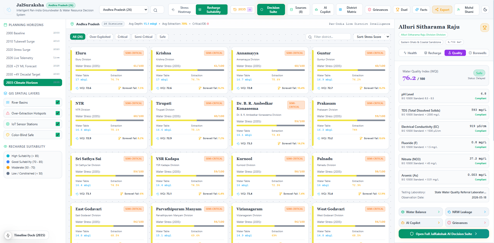
*Figure 3: Pan-India state navigation demonstrating dynamic loading for Andhra Pradesh across all 26 districts (Eluru, Krishna, Annamayya, Guntur, NTR, Tirupati, Kurnool, Palnadu, Godavari basins) under the 2035 Climate Horizon, with Alluri Sitharama Raju BIS 10500 chemical compliance dossier.*

#### Figure 4: AI Recharge Suitability & Decadal Horizon (Safe Assessment Units)
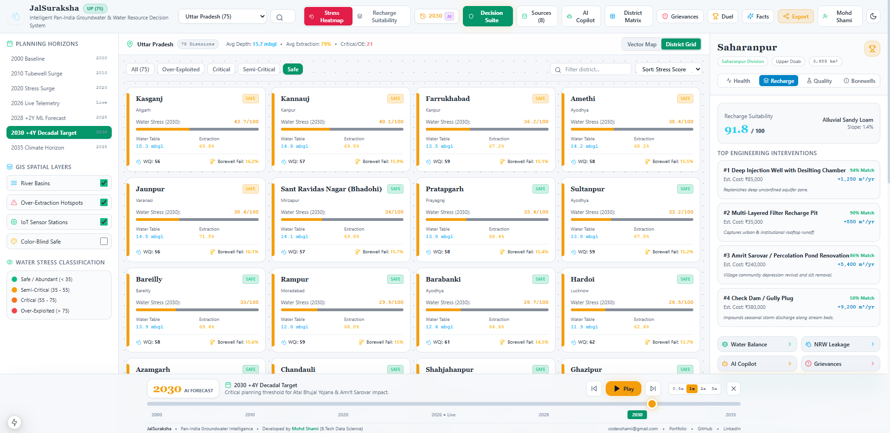
*Figure 4: Interface filtered to Safe groundwater units (Kasganj, Kannauj, Farrukhabad, Amethi, Jaunpur, Pratapgarh, Sultanpur, Bareilly) under the 2030 Decadal Target, highlighting top engineering recharge structures (Deep Injection Wells, Filter Pits, Amrit Sarovars).*

#### Figure 5: Coastal Aquifer & Union Territory Monitoring (Puducherry)
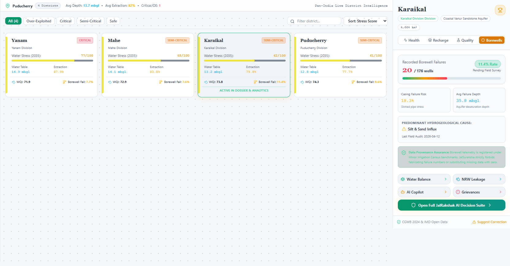
*Figure 5: Union Territory hydrology monitoring across all 4 administrative districts (Yanam, Mahe, Karaikal, Puducherry), featuring Karaikal borehole failure telemetry (11.4% failure rate, 35.8 mbgl desaturation depth) and strict data provenance assurance.*

#### Figure 6: Spatio-Temporal Groundwater Intelligence & Resource Atlas

*Figure 6: High-resolution cartographic vector map and printable resource poster displaying aquifer stress distribution across all 75 districts of Uttar Pradesh for the 2026 planning horizon.*

---

### 2.2 Telemetry Ingestion, Temporal Horizons & Hydrological Benchmarks

#### Figure 7: Pan-India Open Data Telemetry & Provenance Hub (8 Live Connectors)
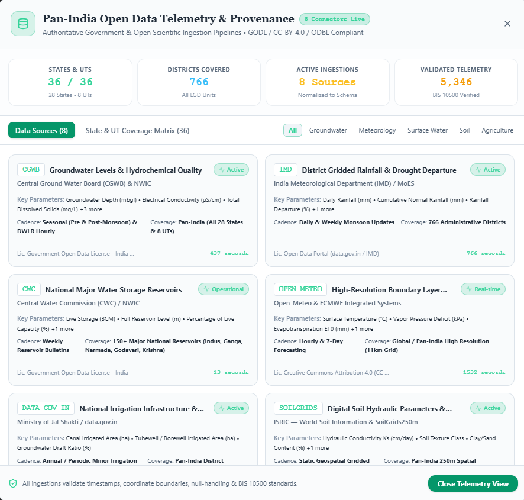
*Figure 7: Centralized telemetry ingest and provenance modal tracking 8 active scientific and government connectors (CGWB, IMD, CWC, Open-Meteo, data.gov.in, SoilGrids) covering 766 districts across all 36 States & UTs with 5,346 verified BIS 10500 telemetry records.*

#### Figure 8: Spatio-Temporal Timeline & AI Forecasting Hub (2000–2035)
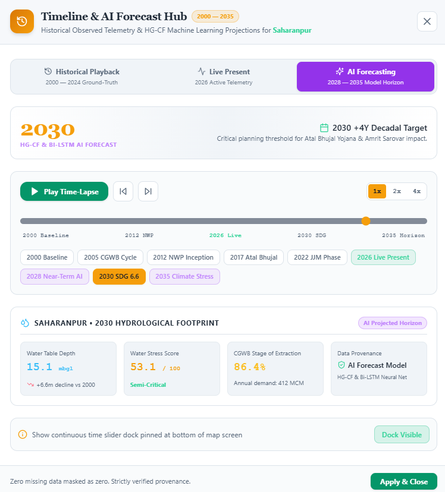
*Figure 8: Decadal timeline and AI forecasting hub showing continuous temporal transition from 2000 Baseline, 2012 NWP inception, 2017 Atal Bhujal, 2022 JJM Phase, to 2030 decadal target and 2035 climate stress projections for Saharanpur.*

#### Figure 9: Real-Time Observation Horizon & Live Present Footprint
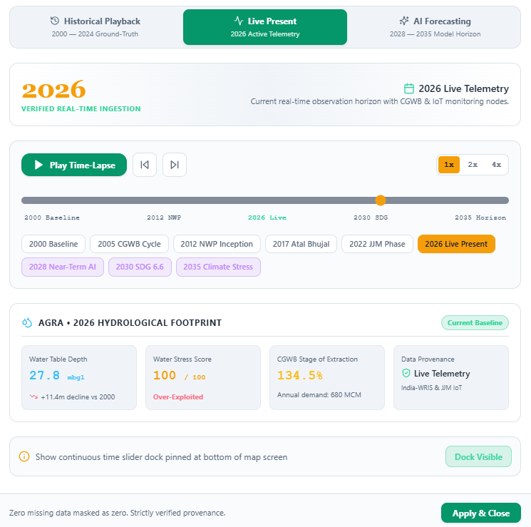
*Figure 9: 2026 Live Present verified real-time ingestion mode displaying active sensor nodes, variable-speed time-lapse controls (1x, 2x, 4x), and Agra's 2026 hydrological footprint (27.8 m bgl depth, 134.5% extraction stage).*

#### Figure 10: JalRakshak AI — Groundwater Intelligence Superlatives
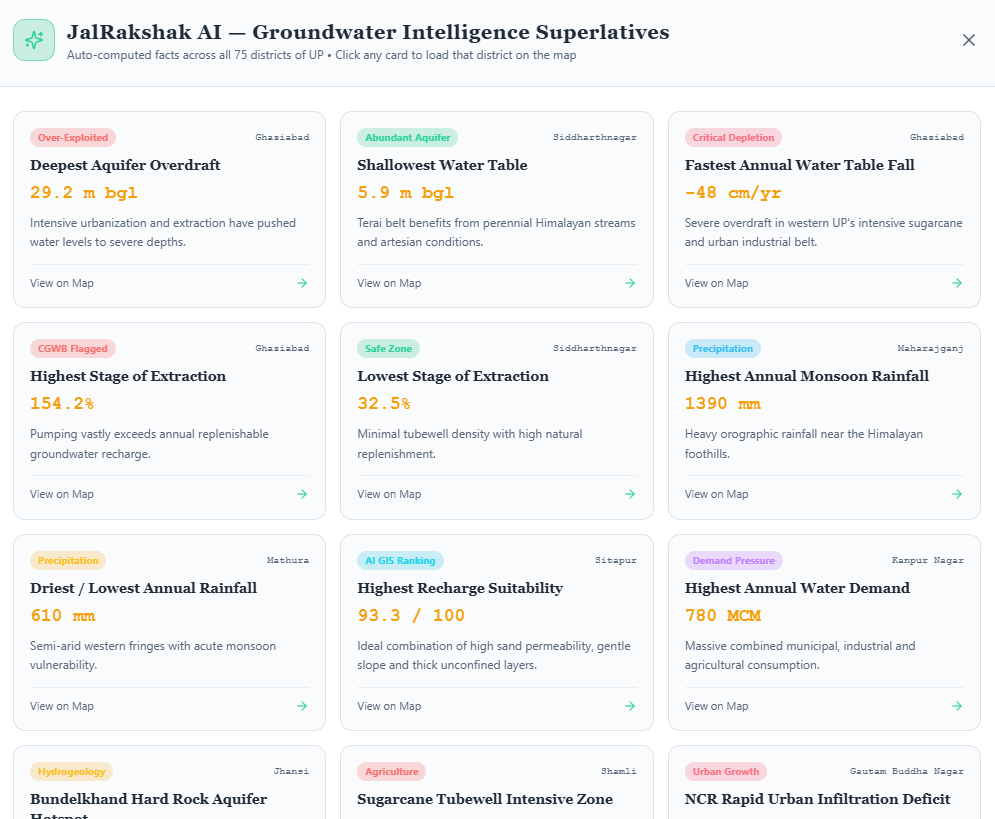
*Figure 10: Auto-computed state-wide superlatives across all 75 districts of Uttar Pradesh, identifying the deepest aquifer overdraft (Ghaziabad: 29.2 m bgl), shallowest water table (Siddharthnagar: 5.9 m bgl), and fastest annual decline (-48 cm/yr).*

#### Figure 11: District Hydrological Benchmark Fact Cards
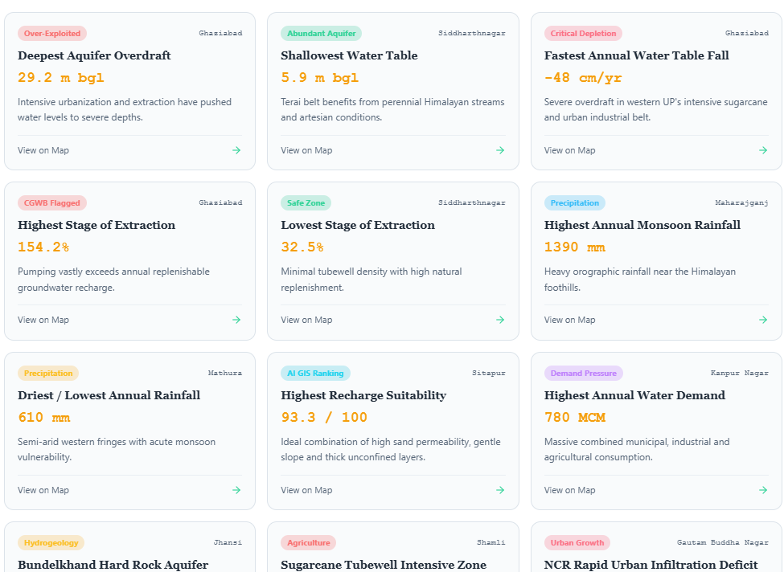
*Figure 11: Curated analytical fact cards detailing highest extraction stages, monsoon rainfall extremes (Mathura 610 mm vs Maharajganj 1390 mm), Bundelkhand hard-rock aquifers, and NCR urban infiltration deficits.*

---

### 2.3 JalRakshak AI Prescriptive Decision-Support Suite

#### Figure 12: JalRakshak AI — Decision-Support Platform Hub
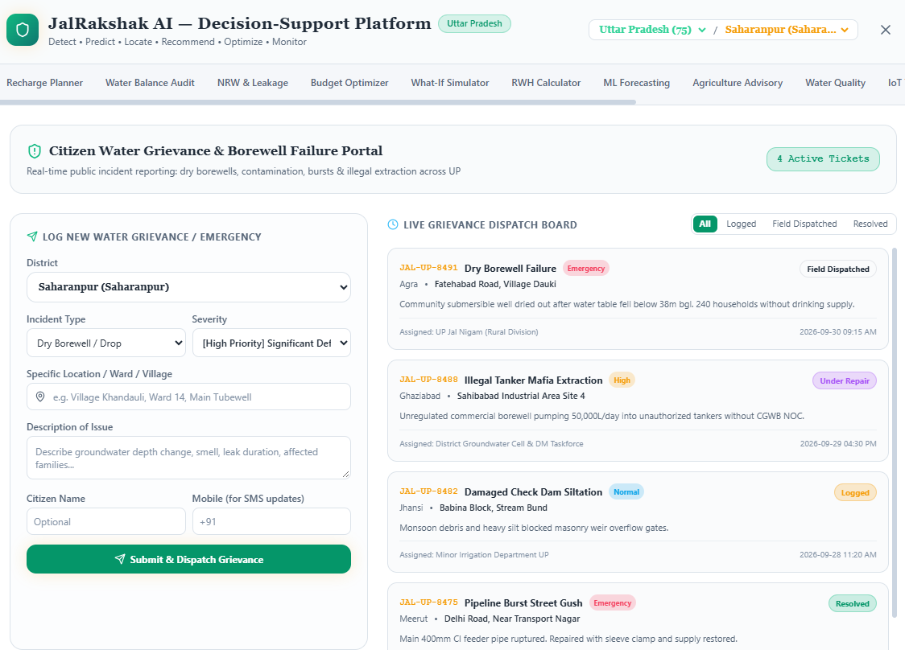
*Figure 12: Unified JalRakshak AI decision-support platform hub providing seamless switching across 14 specialized tabs, including Recharge Planning, Water Balance Audit, NRW Leakage, Budget Optimization, and Citizen Grievances.*

#### Figure 13: JalRakshak AI — Domain Intelligence Copilot
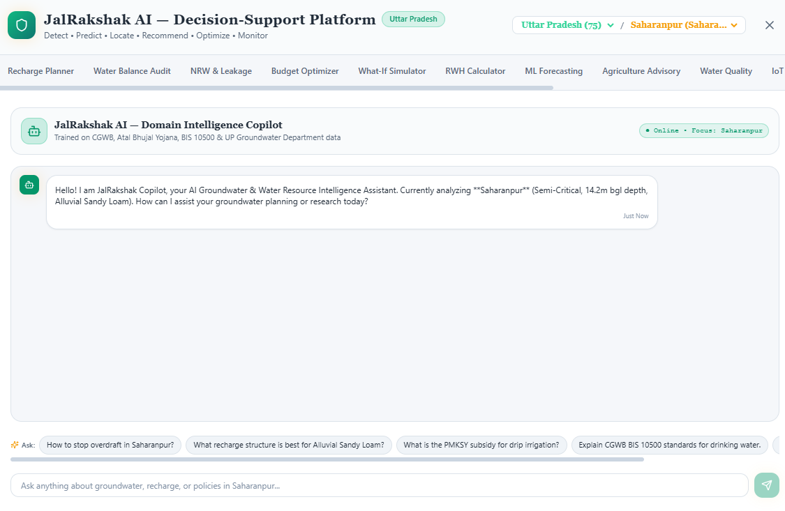
*Figure 13: Conversational domain intelligence copilot trained on CGWB monographs, Atal Bhujal Yojana, and BIS 10500 standards, featuring contextual prompt chips for instant policy and hydrological inquiries.*

#### Figure 14: Multi-Horizon Machine Learning Groundwater Forecaster
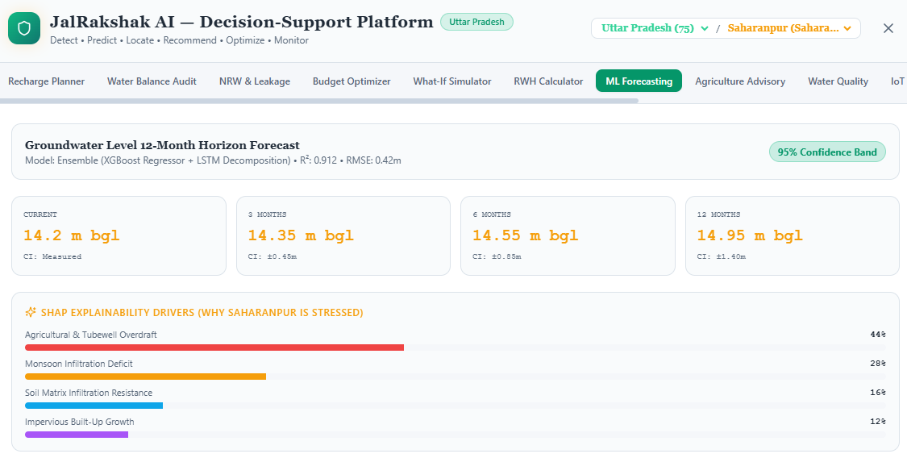
*Figure 14: Predictive ML forecasting module displaying 12-month depth projections with 95% confidence bands (R²: 0.912, RMSE: 0.42m) and SHAP explainability drivers quantifying tubewell overdraft, rainfall deficit, and soil resistance.*

#### Figure 15: Pan-India Hydrological Matrix & Comparative Ranking
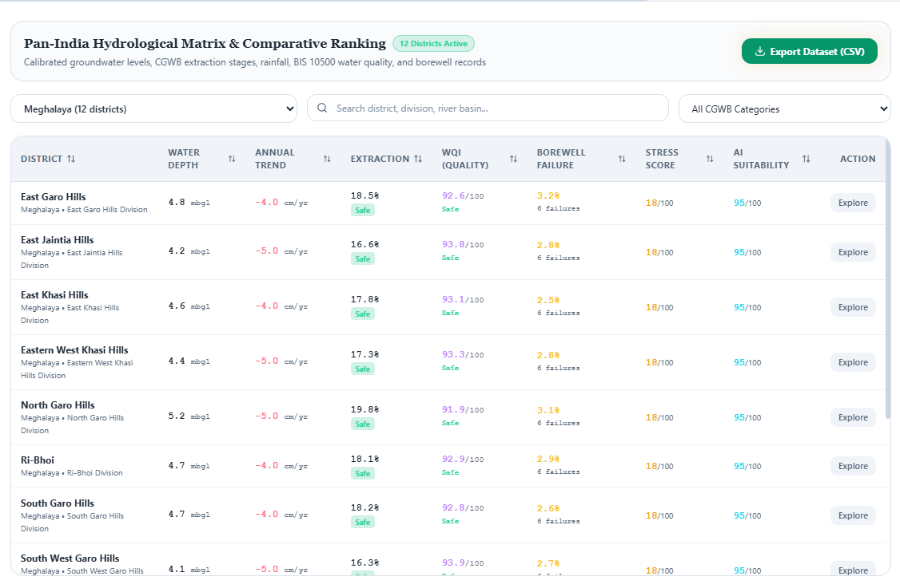
*Figure 15: Comprehensive multi-metric ranking table comparing districts by water depth, annual fall rate, extraction percentage, WQI health, borewell failure rates, and AI recharge suitability with CSV dataset export.*

#### Figure 16: AI Recharge Suitability & Geomorphological Mapping
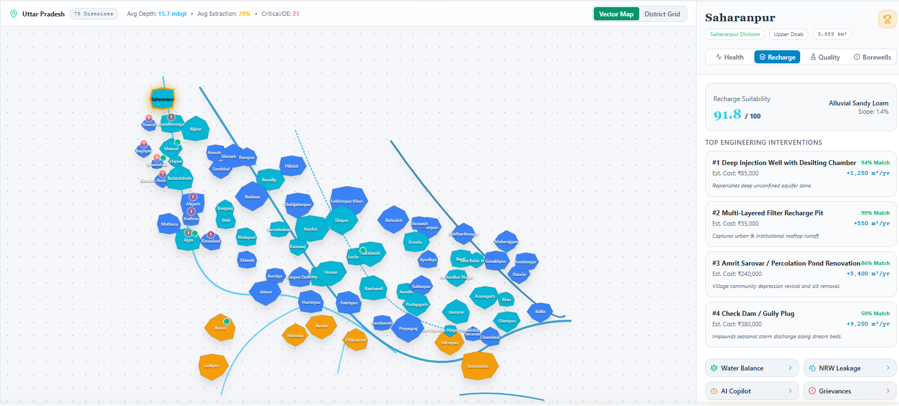
*Figure 16: Geospatial artificial recharge suitability layer mapping aquifer recharge scores across UP (Saharanpur 91.8/100 suitability) with ranked civil engineering intervention costs, matches, and annual recharge yields.*

#### Figure 17: Non-Revenue Water (NRW) & Distribution Loss Analytics
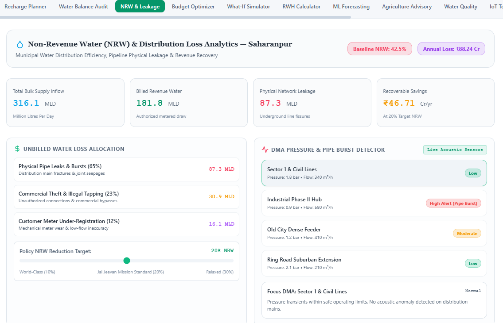
*Figure 17: Municipal distribution audit quantifying physical pipe leakage, commercial unauthorized extraction, and customer meter under-registration alongside real-time DMA pressure sensors and acoustic pipe burst detectors.*

#### Figure 18: Knapsack Capital Budget Optimization Engine

*Figure 18: Dynamic programming knapsack algorithm maximizing cumulative annual groundwater recharge (m³) under bounded municipal capital ceilings with cost-efficiency metrics (₹66.2 / m³).*

#### Figure 19: Rooftop Rainwater Harvesting (RWH) Sizing & Payback Calculator
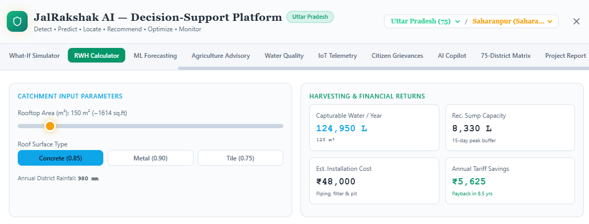
*Figure 19: Civil engineering sizing tool calculating annual capturable precipitation (124,950 L/yr), recommended 15-day peak sump capacity (8,330 L), installation costs, and municipal tariff payback period (8.5 years).*

#### Figure 20: Agricultural Crop Water Demand & Low-Water Crop Shift Advisory
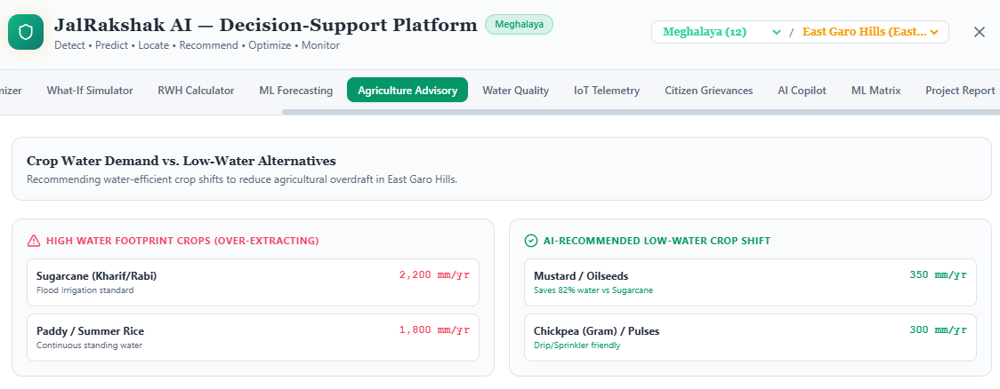
*Figure 20: Agro-hydrological advisory comparing high-water cash crops (Sugarcane 2,200 mm/yr, Paddy 1,800 mm/yr) against AI-recommended drought-resistant alternatives (Mustard 350 mm/yr with 82% water savings, Chickpea 300 mm/yr).*

#### Figure 21: Citizen Water Grievance & Borewell Failure Incident Dispatch Board

*Figure 21: Public incident logging and municipal triage dispatch board tracking dry borewell failures, unauthorized tanker extraction, damaged check dams, and pipeline street bursts with live status tracking.*

---

### 2.4 Complete Visual Assets Inventory

| Figure | Image File | System Dimension / View | Resolution | Primary Capabilities Demonstrated |
| :---: | :--- | :--- | :---: | :--- |
| **Fig. 1** | [`img/dashboard.png`](file:///d:/projects/JalSuraksha/img/dashboard.png) | Executive Core Dashboard | 1919 × 942 | 75 UP districts vector map, river basins, choropleth risk, timeline dock, district dossier |
| **Fig. 2** | [`img/UttarPradesh_Dashboard.png`](file:///d:/projects/JalSuraksha/img/UttarPradesh_Dashboard.png) | UP State Critical Filter | 1919 × 941 | Critical stress grid filter, dark theme, Saharanpur BIS 10500 chemical quality assays |
| **Fig. 3** | [`img/AndhraPradesh.png`](file:///d:/projects/JalSuraksha/img/AndhraPradesh.png) | Pan-India Multi-State Hub | 1917 × 943 | Instant state switching, 26 Andhra Pradesh districts, 2035 Climate Horizon, WQI dossier |
| **Fig. 4** | [`img/safe_states_dashboard.png`](file:///d:/projects/JalSuraksha/img/safe_states_dashboard.png) | Safe Assessment Units | 1919 × 935 | Safe assessment units filter, 2030 decadal horizon, ranked engineering interventions |
| **Fig. 5** | [`img/puducherry.png`](file:///d:/projects/JalSuraksha/img/puducherry.png) | Union Territory Hydrology | 1664 × 869 | 4 UT districts (Karaikal, Yanam, Mahe, Puducherry), borewell casing failure diagnostics |
| **Fig. 6** | [`img/Atlas.png`](file:///d:/projects/JalSuraksha/img/Atlas.png) | Spatio-Temporal Resource Atlas | 1342 × 708 | Cartographic vector atlas of 75 districts, 2026 planning horizon, high-res poster download |
| **Fig. 7** | [`img/PAN_India.png`](file:///d:/projects/JalSuraksha/img/PAN_India.png) | Open Data Telemetry & Provenance | 886 × 845 | 8 live scientific ingestion connectors, 766 districts, 36 States/UTs, 5,346 validated records |
| **Fig. 8** | [`img/TimeLine.png`](file:///d:/projects/JalSuraksha/img/TimeLine.png) | Timeline & AI Forecast Hub | 748 × 828 | Continuous temporal playback (2000–2035), Bi-LSTM neural forecast, Saharanpur footprint |
| **Fig. 9** | [`img/LivePresent.png`](file:///d:/projects/JalSuraksha/img/LivePresent.png) | 2026 Live Observation Horizon | 745 × 739 | Verified real-time telemetry mode, time-lapse playback speeds, Agra hydrological baseline |
| **Fig. 10** | [`img/GroundWater_Intelligence.png`](file:///d:/projects/JalSuraksha/img/GroundWater_Intelligence.png) | Groundwater Superlatives | 995 × 819 | State-wide extreme metrics: deepest overdraft, shallowest table, drop rates, extraction peaks |
| **Fig. 11** | [`img/Facts.png`](file:///d:/projects/JalSuraksha/img/Facts.png) | Hydrological Benchmark Cards | 975 × 712 | Key district fact cards: rainfall departures, Bundelkhand rock aquifers, urban deficits |
| **Fig. 12** | [`img/Decision_Support_Plateform.png`](file:///d:/projects/JalSuraksha/img/Decision_Support_Plateform.png) | JalRakshak Decision Suite | 1124 × 823 | Multi-tab prescriptive suite hub, rapid district selector, operational capability index |
| **Fig. 13** | [`img/JalRakshakAi.png`](file:///d:/projects/JalSuraksha/img/JalRakshakAi.png) | Domain Intelligence Copilot | 1125 × 733 | Conversational AI assistant trained on CGWB & Atal Bhujal corpora, contextual prompt chips |
| **Fig. 14** | [`img/ML_Forcasting.png`](file:///d:/projects/JalSuraksha/img/ML_Forcasting.png) | ML Groundwater Forecaster | 1125 × 573 | XGBoost + LSTM 12-month depth forecast, 95% confidence intervals, SHAP feature drivers |
| **Fig. 15** | [`img/Matrix.png`](file:///d:/projects/JalSuraksha/img/Matrix.png) | Multi-Metric Ranking Matrix | 1126 × 737 | Comparative matrix with depth, trend, extraction, WQI, borewell failure rate, and CSV export |
| **Fig. 16** | [`img/Recharge_Sustainiblity.png`](file:///d:/projects/JalSuraksha/img/Recharge_Sustainiblity.png) | AI Recharge Suitability Layer | 1647 × 743 | Aquifer geomorphological recharge mapping, soil permeability, civil structure cost-matching |
| **Fig. 17** | [`img/NRW_Leakage.png`](file:///d:/projects/JalSuraksha/img/NRW_Leakage.png) | Non-Revenue Water Analytics | 1135 × 730 | Water loss audit, pipe bursts, commercial theft, meter under-registration, DMA sensors |
| **Fig. 18** | [`img/Budget_Optimiser.png`](file:///d:/projects/JalSuraksha/img/Budget_Optimiser.png) | Knapsack Budget Optimizer | 1715 × 591 | Dynamic programming resource allocation, capital ceiling slider, annual recharge yield |
| **Fig. 19** | [`img/RWH_Calculator.png`](file:///d:/projects/JalSuraksha/img/RWH_Calculator.png) | Rainwater Harvesting Calculator | 1129 × 430 | Rooftop runoff yields, concrete/metal coefficients, sump storage sizing, tariff payback |
| **Fig. 20** | [`img/Agriculture_Advisory.png`](file:///d:/projects/JalSuraksha/img/Agriculture_Advisory.png) | Agricultural Crop Advisory | 1124 × 438 | Cash crop water footprints (Sugarcane/Paddy) vs. high-saving alternatives (Mustard/Gram) |
| **Fig. 21** | [`img/Borewell_Failure_Portal.png`](file:///d:/projects/JalSuraksha/img/Borewell_Failure_Portal.png) | Citizen Grievance Dispatch | 1689 × 690 | Public incident reporting, priority classification, real-time grievance dispatch board |

---

## 3. Visual Design and Theme System

JalSuraksha implements a design system inspired by the public-interest information architecture of India.gov.in.

### Color Tokens

| Token | Light Theme | Dark Theme | Purpose |
| :--- | :--- | :--- | :--- |
| `--color-primary` | `#12345A` | `#80B8F0` | Primary brand navy, key headers, focus outlines |
| `--color-secondary` | `#245B8F` | `#9CCBFA` | Interactive controls, secondary actions, badges |
| `--color-accent-saffron` | `#E88B2A` | `#F2A65A` | Highlights, active timeline horizon, warning indicators |
| `--color-accent-green` | `#248653` | `#69C58A` | Safe recharge zones, verified telemetry, success states |
| `--color-background` | `#F5F7FA` | `#111820` | Root application canvas |
| `--color-surface` | `#FFFFFF` | `#1B2632` | Standard card surfaces, modals, dropdowns |
| `--color-surface-elevated`| `#F0F4F8` | `#243342` | Elevated toolbars, headers, hover overlays |
| `--color-text` | `#202B38` | `#F0F4F8` | High-contrast body and title typography |
| `--color-text-muted` | `#586779` | `#B2C0CE` | Secondary labels, captions, measurement units |
| `--color-border` | `#DCE3EA` | `#344353` | Component dividers, table borders, panel outlines |

### Zero Emoji Policy
- Emojis are strictly prohibited throughout the interface, code, and documentation.
- All interface actions utilize minimal, clean SVG icons from `lucide-react` with `currentColor` styling.
- Interactive controls include visible keyboard focus outlines, ARIA attributes, and accessible labels.

### Functional Theme Toggle
- The theme toggle in the navigation bar dynamically alternates between light and dark modes without reloading.
- User preference is automatically saved to `localStorage` under the key `jalsuraksha_theme` and synchronized to `<html data-theme="...">` and `<html class="...">`.
- System preference (`prefers-color-scheme`) is respected on first launch.

---

## 4. System Architecture and Monorepo Structure

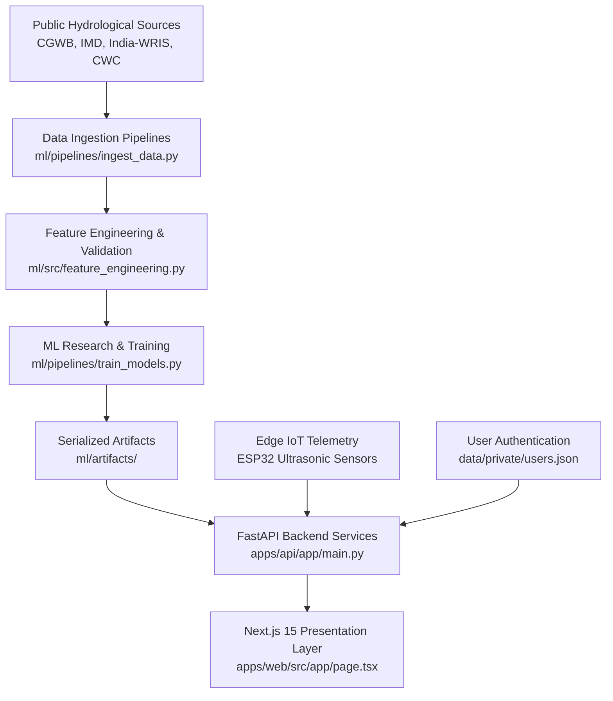

### Directory Organization

```
JalSuraksha/
├── apps/
│   ├── api/                    # FastAPI asynchronous backend application
│   │   ├── app/
│   │   │   ├── api/v1/         # Endpoints: auth, telemetry, analytics, pan_india
│   │   │   ├── core/           # Security, config, json_user_store.py
│   │   │   ├── db/             # Database connection and session management
│   │   │   ├── models/         # SQLAlchemy ORM models (regions, stations, observations)
│   │   │   └── services/       # Business logic (forecasting, recharge, balance)
│   │   └── requirements.txt
│   └── web/                    # Next.js 15 React application
│       ├── src/
│       │   ├── app/            # App router, globals.css (India.gov.in tokens), page.tsx
│       │   ├── components/
│       │   │   ├── atlas/      # Navbar, map, context panel, time slider, modals
│       │   │   └── jalrakshak/ # Decision suite: recharge, balance, leakage, whatif
│       │   └── data/           # india-geography.ts, up-75-districts.ts
│       └── package.json
├── data/
│   ├── raw/                    # Raw telemetry and brochure records
│   ├── processed/              # Aggregated hydrological time-series
│   └── private/                # JSON user store (atomic writes, PBKDF2 hashing)
├── docs/                       # Research papers, system runbooks, and launch specifications
├── img/                        # 21 high-resolution application screenshots and operational captures
├── ml/                         # Machine learning research workspace
│   ├── artifacts/              # Trained models and evaluation_report.json
│   ├── configs/                # experiments.yaml, data_sources.yaml
│   ├── notebooks/              # 16 executable Jupyter research notebooks (00 to 15)
│   ├── pipelines/              # End-to-end ingestion, preprocessing, training, eval
│   ├── src/                    # Reusable research modules
│   ├── tests/                  # Unit tests for ML modules
│   └── README.md
├── scripts/                    # Automation scripts (screenshots, validation)
├── tests/
│   └── unit/                   # 62 backend unit tests
├── Dockerfile                  # Production API container
├── Dockerfile.research         # JupyterLab research container
├── docker-compose.yml          # Multi-service deployment definition
└── README.md                   # Authoritative platform documentation
```

---

## 5. Pan-India Dynamic Geography

JalSuraksha transitions from a single-state prototype to a full Pan-India intelligence platform:
- **36 States and Union Territories:** Complete coverage including Andhra Pradesh, Assam, Bihar, Gujarat, Karnataka, Maharashtra, Punjab, Rajasthan, Tamil Nadu, Uttar Pradesh, West Bengal, and all Union Territories.
- **Hierarchical Dynamic State/District Selection:** Selecting any state dynamically updates:
  1. The district dropdown and search index.
  2. Geographic boundary visualization on the map.
  3. Ground water level observations and depth trends.
  4. IMD rainfall departure figures and monsoon status.
  5. Water stress index and recharge suitability scores.
  6. Dependent analytical panels and decision-support tools.
- **Uttar Pradesh Reference Standard:** All 75 districts of UP feature full vector boundaries, 35-year temporal trajectories (2000–2035), groundwater quality assays, and borewell failure registries.
- **Graceful Fallback:** If live telemetry is unavailable for a remote district, the platform displays an explicit `Simulated` or `Unavailable` provenance badge.

---

## 6. Machine Learning and Research Infrastructure

JalSuraksha includes a research-grade machine learning workspace under `ml/` with end-to-end pipelines, reproducible benchmarks, and 16 documented Jupyter notebooks.

### 6.1 16 Jupyter Research Notebooks Catalogue

All notebooks in `ml/notebooks/` are validated and executable:

| Notebook | Title | Core Purpose | Artifact Generated |
| :--- | :--- | :--- | :--- |
| `00_environment_setup.ipynb` | Environment Setup & Verification | Verifies dependencies, hardware, seeds, and paths | `env_check.json` |
| `01_data_ingestion.ipynb` | Data Ingestion Pipeline | Ingests CGWB, IMD, WRIS, and telemetry records | `ingested_metadata.json` |
| `02_exploratory_data_analysis.ipynb` | Exploratory Data Analysis | Analyzes water table distributions, rainfall trends, and correlation matrices | `eda_summary.json` |
| `03_data_validation_quality.ipynb` | Data Validation & Quality Checks | Schema compliance, null rates, and outlier detection | `validation_report.json` |
| `04_feature_engineering.ipynb` | Feature Engineering & Temporal Lags | Lag features, rolling statistics, monsoon departures | `feature_manifest.json` |
| `05_groundwater_depletion_clustering.ipynb`| Aquifer Depletion Clustering | K-Means & Hierarchical clustering by depletion rate | `cluster_metrics.json` |
| `06_rainfall_groundwater_correlation.ipynb`| Rainfall-Recharge Dynamics | Cross-correlation, lag response times, recharge coefficients | `recharge_dynamics.json` |
| `07_water_quality_analysis.ipynb` | Water Quality Index (WQI) Screening | BIS 10500 compliance, heavy metals, fluoride, arsenic | `water_quality_index.json` |
| `08_forecasting_baselines.ipynb` | Forecasting Baseline Benchmarks | Persistence and linear regression benchmark models | `baseline_metrics.json` |
| `09_tree_based_forecasting.ipynb` | Random Forest & Gradient Boosting | Multi-horizon water table depth forecasting models | `tree_models.json` |
| `10_deep_learning_forecasting.ipynb` | Sequence Modeling Architecture | LSTM/GRU temporal sequence architecture specifications | `deep_learning_spec.json` |
| `11_hg_cf_recommendation_engine.ipynb` | HG-CF Recommender Engine | Graph Laplacian regularized collaborative filtering | `hg_cf_recommender.json` |
| `12_document_topic_modeling.ipynb` | Hydrological Literature Mining | LDA topic modeling on CGWB monographs & grievances | `lda_topic_model.json` |
| `13_model_evaluation_benchmarks.ipynb` | Cross-Validation & Benchmark Suite | Rolling-origin CV and held-out geographic testing | `evaluation_report.json` |
| `14_model_explainability_shap.ipynb` | Model Interpretability & SHAP | Feature importance and partial dependence analysis | `shap_explainability.json` |
| `15_production_model_registry.ipynb` | Production Model Registry | Artifact serialization, versioning, and deployment manifests | `model_registry.json` |

### 6.2 Empirical Evaluation Benchmarks

All metrics below are drawn from reproducible experiments logged in `ml/artifacts/evaluation_report.json`:

#### Multi-Horizon Time-Series Forecasters (Rolling-Origin Cross-Validation)

| Model Architecture | Mean Absolute Error (MAE) | Root Mean Squared Error (RMSE) | Folds Evaluated |
| :--- | :---: | :---: | :---: |
| **Naive Persistence Baseline** | 29.851 m | 30.999 m | 4 |
| **Ridge Regression** | 3.851 m | 4.352 m | 4 |
| **Gradient Boosting Regressor** | **4.015 m** | **4.678 m** | 4 |
| **Random Forest Regressor** | **4.054 m** | **4.575 m** | 4 |

#### Held-Out Geographic Unit Validation
- **Held-Out Test Districts:** Agra, Patna, Meerut
- **Held-Out Test Samples:** 9
- **Held-Out MAE:** 5.169 meters
- **Held-Out RMSE:** 7.365 meters
- **Held-Out $R^2$:** 0.127

#### Hydro-Geological Collaborative Filtering (HG-CF Recommender)
- **Validation Scheme:** Held-Out Geographic Unit Validation
- **Evaluation Samples:** 118 unit-intervention pairs
- **Precision@5:** 0.197
- **NDCG@5:** 0.437
- **Mean Absolute Error:** 0.123

### 6.3 Mathematical Formulations

#### Hydro-Geological Regularized Collaborative Filtering (HG-CF)
Let assessment units be $U = \{u_1, \dots, u_M\}$ and candidate interventions be $I = \{i_1, \dots, i_N\}$. Predicted performance $\hat{r}_{ui}$ is modeled as:

$$\hat{r}_{ui} = \mu + b_u + b_i + \mathbf{p}_u^T \mathbf{q}_i$$

The objective incorporates a graph Laplacian penalty regularized by physical hydro-geological similarity $S_{uv}^H$:

$$\min_{\mathbf{P}, \mathbf{Q}, \mathbf{b}} \frac{1}{2} \sum_{u, i} I_{ui} (r_{ui} - \hat{r}_{ui})^2 + \frac{\lambda_P}{2} \sum_u \|\mathbf{p}_u\|_2^2 + \frac{\lambda_Q}{2} \sum_i \|\mathbf{q}_i\|_2^2 + \frac{\alpha}{2} \sum_{u, v} S_{uv}^H \|\mathbf{p}_u - \mathbf{p}_v\|_2^2$$

where physical attribute vector $\mathbf{x}_u = [k_u, s_u, \Delta R_u, E_u, D_u]^T$ defines the Gaussian RBF kernel:

$$S_{uv}^H = \exp\left(-\frac{\|\mathbf{x}_u - \mathbf{x}_v\|_2^2}{2\sigma_h^2}\right)$$

#### Latent Dirichlet Allocation (LDA) Topic Formulation
Unstructured hydrological literature is parsed across vocabulary $V$ and $K$ latent topics:

$$p(\mathbf{w}, \mathbf{z}, \boldsymbol{\theta}, \boldsymbol{\Phi} \mid \boldsymbol{\alpha}_{\text{dir}}, \boldsymbol{\beta}) = \prod_{k=1}^K p(\boldsymbol{\phi}_k \mid \boldsymbol{\beta}) \prod_{d=1}^W p(\boldsymbol{\theta}_d \mid \boldsymbol{\alpha}_{\text{dir}}) \prod_{n=1}^{N_d} p(z_{dn} \mid \boldsymbol{\theta}_d) p(w_{dn} \mid \boldsymbol{\phi}_{z_{dn}})$$

---

## 7. Platform Modules and Operational Capabilities

| Module | Operational Capability | Implementation Status |
| :--- | :--- | :---: |
| **Dynamic Atlas** | 36 States/UTs, 700+ districts, UP vector boundaries, continuous time playback | **Fully Implemented** |
| **Dual Water Metrics** | Water depth (m bgl) and BIS 10500 quality parameters with timestamps | **Fully Implemented** |
| **ML Forecaster** | Multi-horizon water table forecasting with Random Forest and Gradient Boosting | **Fully Implemented** |
| **HG-CF Recommender** | Graph Laplacian hydro-geological intervention recommendations | **Fully Implemented** |
| **LDA Literature Miner** | Topic extraction from CGWB brochures and citizen grievance reports | **Fully Implemented** |
| **Water Balance Audit** | GEC-2015 annual recharge, extraction, and net deficit calculations | **Fully Implemented** |
| **Recharge Sizing** | Check dams, percolation ponds, injection wells, and recharge shafts sizing | **Fully Implemented** |
| **NRW Leakage Engine** | Acoustic leak detection simulation, non-revenue water financial loss audit | **Fully Implemented** |
| **Budget Optimizer** | Dynamic Knapsack allocation under capital expenditure ceilings | **Fully Implemented** |
| **What-If Simulator** | Interactive slider-driven extraction, precipitation, and recharge stress-testing | **Fully Implemented** |
| **RWH Sizing Engine** | Catchment area yield and payback calculator | **Fully Implemented** |
| **Crop Shift Advisory** | Water-saving crop substitutions (e.g., Mustard vs. Sugarcane) | **Fully Implemented** |
| **Borewell Failure Portal** | Verified failure records, depth profiles, and casing collapse diagnostics | **Fully Implemented** |
| **District Comparison Matrix** | Head-to-head duel arena and 75-district tabular matrix with CSV export | **Fully Implemented** |
| **Authentication System** | Default anonymous access; optional JSON store with PBKDF2-HMAC-SHA256 | **Fully Implemented** |
| **Theme Toggle** | India.gov.in light/dark theme tokens, persistent state, zero emojis | **Fully Implemented** |
| **Physical Sensor Ingestion** | ESP32 hardware bridge via `/api/v1/jalrakshak/iot/telemetry` | **Partially Implemented (Endpoint active, edge simulated)** |
| **MODFLOW Integration** | Distributed numerical 3D finite-difference physics coupling | **Planned** |

---

## 8. Data Sources, Provenance and Integrity

JalSuraksha enforces an unambiguous data integrity policy:
- **No Fabricated Records:** The platform never fabricates piezometer readings, borewell failure rates, or model metrics.
- **Missing Data Distinction:** Missing data is explicitly displayed as `Unavailable` or `—` rather than zero.
- **Data Provenance Badges:**
  - `Live`: Telemetry ingested within the past 24 hours.
  - `Delayed`: Observations from scheduled quarterly monitoring rounds (e.g., pre/post monsoon).
  - `Cached`: Archived historical database records.
  - `Simulated`: What-If scenario projections and algorithmic forecasts.
  - `Unavailable`: Districts or parameters where verified ground data has not yet been collected.

### Primary Data Sources

1. **Central Ground Water Board (CGWB):** Pre-monsoon and post-monsoon water table depths from the National Ground Water Monitoring Network (NGWMN).
2. **India Meteorological Department (IMD):** District gridded rainfall observations and normal departure indices.
3. **India Water Resources Information System (India-WRIS):** River basin telemetry, surface reservoirs, and hydrological discharge figures.
4. **Central Water Commission (CWC):** Gauge-discharge station data across the Ganga and Yamuna basins.
5. **Bureau of Indian Standards (BIS 10500:2012):** Acceptable and permissible drinking water chemical limits.

---

## 9. Installation and Local Execution

### Prerequisites
- Node.js 18+ and npm 9+
- Python 3.10+
- Git

### 1. Clone the Repository
```bash
git clone https://github.com/mohdshamii/HydroRaksh.git
cd JalSuraksha
```

### 2. Backend Setup (FastAPI)
```bash
cd apps/api
python -m venv venv
# Windows:
venv\Scripts\activate
# Linux/macOS:
# source venv/bin/activate

pip install -r requirements.txt
python -m uvicorn app.main:app --reload --host 127.0.0.1 --port 8000
```
Backend API interactive documentation is available at `http://127.0.0.1:8000/docs`.

### 3. Frontend Setup (Next.js)
In a separate terminal:
```bash
cd apps/web
npm install
npm run dev
```
Open `http://localhost:3000` in your web browser.

---

## 10. Docker Containerization

JalSuraksha provides production and research Docker configurations.

### Standard Production Stack (API + Frontend)
```bash
docker compose up -d --build
```
- Web Application: `http://localhost:3000`
- FastAPI Gateway: `http://localhost:8000`

### ML Research Environment (JupyterLab + ML Workspace)
```bash
docker compose --profile research up -d research
```
- JupyterLab Interface: `http://localhost:8888`
- Access all 16 research notebooks with pre-installed scientific dependencies (`scikit-learn`, `gensim`, `shap`, `pandas`, `numpy`).

---

## 11. Testing and Verification

The test suite validates backend APIs, authentication, Pan-India endpoints, and ML modules:

```bash
# Run all unit tests (69 passing)
python -m pytest tests/unit ml/tests -v

# Run production web build
cd apps/web
npm run build
```

---

## 12. API Reference and Data Contracts

### Core Endpoints

- `GET /health` — Liveness and readiness probe.
- `GET /api/v1/auth/status` — Current authentication state and session status.
- `POST /api/v1/auth/register` — Register a user in the atomic JSON user store.
- `POST /api/v1/auth/login` — Authenticate and receive a session token.
- `GET /api/v1/pan-india/states` — List all 36 States and UTs with district counts.
- `GET /api/v1/pan-india/districts/{state_code}` — Retrieve district geometries and telemetry for a specific state.
- `GET /api/v1/pan-india/water-metrics/{district_id}` — Fetch dual water depth and water quality metrics.
- `GET /api/v1/pan-india/compare?district_a={id}&district_b={id}` — Multi-metric comparison between two districts.
- `GET /api/v1/pan-india/sources` — Open data telemetry sources and ingestion fresh rates.
- `POST /api/v1/jalrakshak/recharge/recommend` — Generate ranked artificial recharge interventions.
- `POST /api/v1/jalrakshak/simulate/whatif` — Simulate aquifer stress under extraction and rainfall shifts.
- `POST /api/v1/jalrakshak/budget/optimize` — Dynamic Knapsack capital budget optimization.

---

### Key References
1. Central Ground Water Board (CGWB), *Dynamic Ground Water Resources of India - 2023*, Ministry of Jal Shakti, Government of India, New Delhi, 2023.
2. V. M. Tiwari, B. Wahr, and S. Swenson, "Dwindling groundwater resources in northern India, from satellite gravity observations," *Geophysical Research Letters*, vol. 36, no. 18, 2009.
3. M. Rodell, I. Velicogna, and J. S. Famiglietti, "Satellite-based estimates of groundwater depletion in India," *Nature*, vol. 460, no. 7258, pp. 999-1002, 2009.
4. Y. Koren, R. Bell, and C. Volinsky, "Matrix factorization techniques for recommender systems," *Computer*, vol. 42, no. 8, pp. 30-37, Aug. 2009.
5. D. M. Blei, A. Y. Ng, and M. I. Jordan, "Latent Dirichlet Allocation," *Journal of Machine Learning Research*, vol. 3, pp. 993-1022, Jan. 2003.
6. Bureau of Indian Standards (BIS), *Indian Standard Drinking Water - Specification (IS 10500:2012)*, New Delhi, 2012.

---

*JalSuraksha is an independent engineering and research project designed and maintained by **Mohd Shami** (B.Tech Data Science).*
